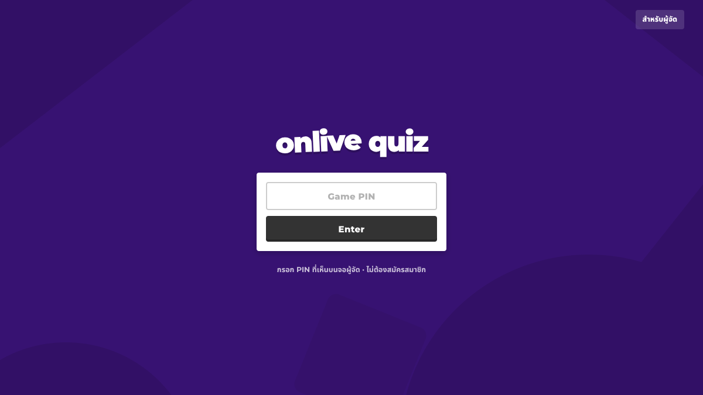
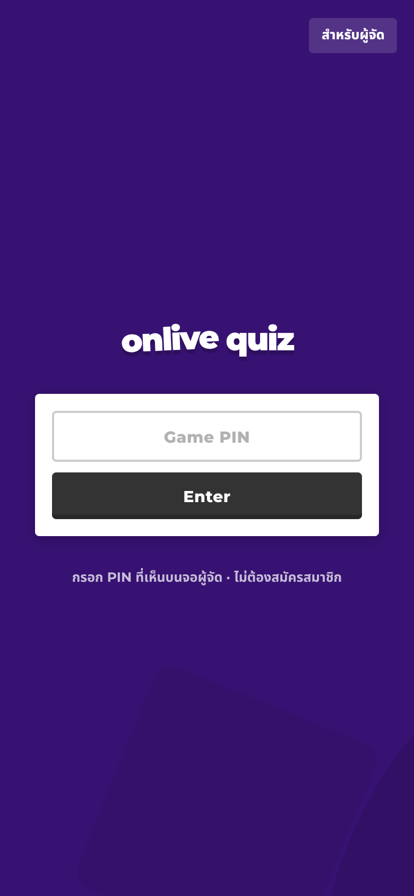
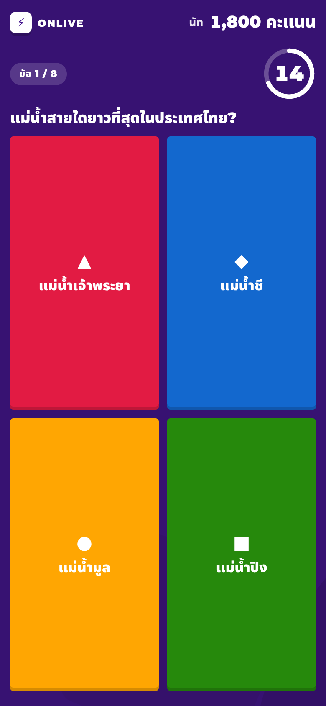
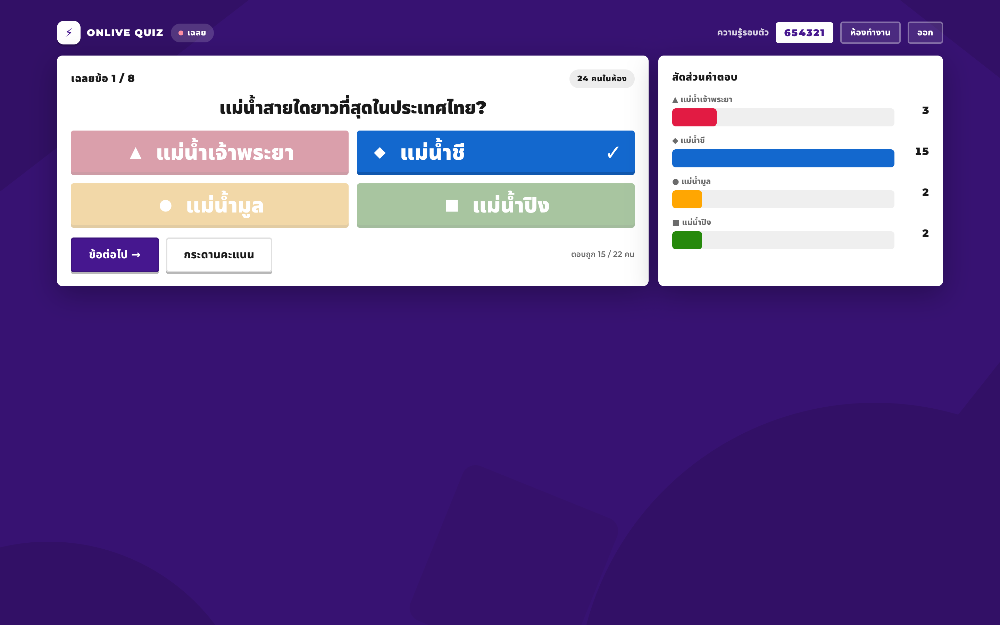
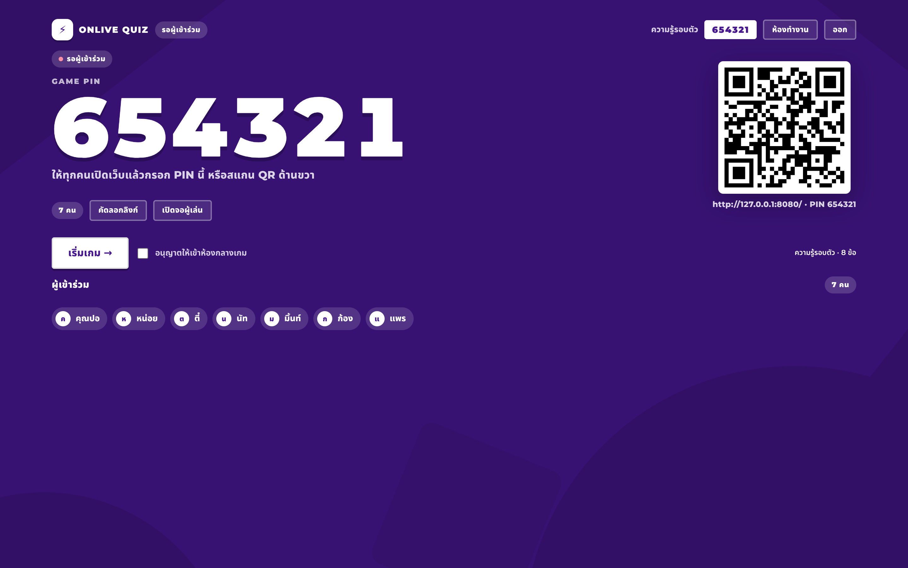
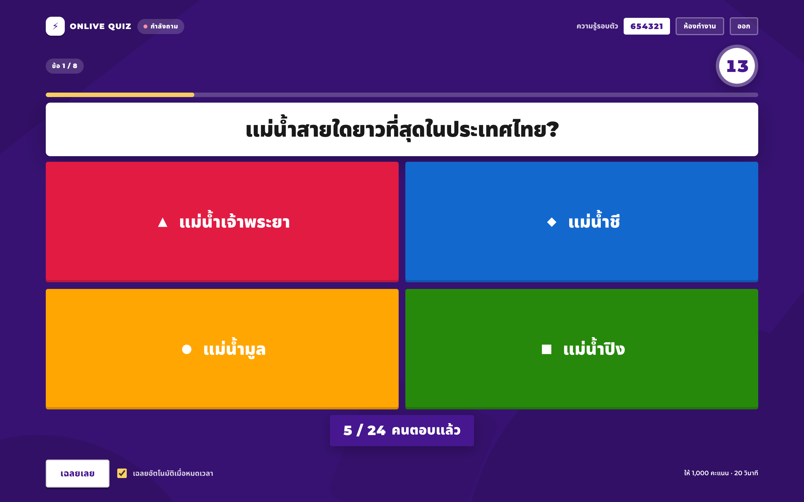

# ⚡ ONLIVE QUIZ — เกมตอบคำถามสดสำหรับงานอบรม

เว็บเกมตอบคำถามแบบ Kahoot สำหรับใช้ในห้องอบรม **รองรับผู้เล่นพร้อมกัน 80–100 คน**
ผู้จัดสร้างห้อง → ผู้เข้าอบรมสแกน QR หรือกรอก PIN แล้วแข่งกันตอบคำถาม → คะแนนขึ้นกระดานอันดับแบบเรียลไทม์

- 🌐 หน้าเว็บโฮสต์บน **GitHub Pages** (ฟรี ไม่มีค่าใช้จ่าย)
- 🗄️ ข้อมูลและเรียลไทม์ใช้ **Supabase** (Postgres + Realtime)
- 📥 นำเข้าข้อสอบได้จาก **CSV / Excel / JSON**
- 🔒 เฉลยและคะแนนคำนวณที่ฐานข้อมูล ผู้เล่นแก้คะแนนหรือดักดูเฉลยไม่ได้
- 🎨 ดีไซน์แนว Kahoot — พื้นม่วง ปุ่มคำตอบสี 4 ทรง (▲ ◆ ● ■) การ์ดขาว และจอผู้จัดพื้นขาวสำหรับโปรเจกเตอร์

---

## หน้าตา

| เข้าร่วม (เดสก์ท็อป) | เข้าร่วม (มือถือ) |
|---|---|
|  |  |

| เล่นเกม (มือถือ) | จอผู้จัด — เฉลย |
|---|---|
|  |  |

| จอผู้จัด — ห้องรอ | จอผู้จัด — คำถาม |
|---|---|
|  |  |

> ค่าสี/ขนาด/ระยะทั้งหมดวัดจาก kahoot.it จริง (สแกนพิกเซล + วัดกล่อง) และบันทึกหลักฐานไว้ที่
> [`docs/design/kahoot-study.md`](docs/design/kahoot-study.md)

---

## เริ่มใช้งานเร็ว ๆ

| ใคร | ลิงก์ | ทำอะไร |
|---|---|---|
| ผู้เข้าอบรม | `https://tonsao2024.github.io/online-quiz-live/` | กรอก PIN หรือสแกน QR |
| ผู้จัด / แอดมิน | `…/admin.html` | สร้างชุดข้อสอบ นำเข้าไฟล์ เปิดห้อง |
| จอคุมเกม | `…/host.html?room=<id>` | แชร์ PIN/QR กดเริ่ม–เฉลย–กระดานคะแนน |

ขั้นตอนใช้งานจริงหน้างาน

1. ผู้จัดเข้าสู่ระบบที่หน้าแรก → เข้าห้องทำงาน
2. สร้างชุดข้อสอบใหม่ (หรือกด **นำเข้าข้อสอบ** แล้ววาง CSV/JSON)
3. กด **เล่นเลย** → ระบบสร้างห้องและ PIN 6 หลัก พร้อม QR บนจอ
4. ให้ผู้เข้าอบรมสแกน QR (หรือเปิดเว็บแล้วกรอก PIN) แล้วใส่ชื่อ
5. กด **เริ่มเกม →** แล้วกด `space` / `ลูกศรขวา` เพื่อไปข้อถัดไป
6. จบเกม → ระบบสรุปอันดับให้อัตโนมัติ

---

## ทำไมต้องมี Supabase (ทั้งที่เว็บอยู่บน GitHub Pages)

GitHub Pages เป็นที่โฮสต์ **ไฟล์นิ่ง** เท่านั้น — ไม่มีเซิร์ฟเวอร์ ไม่มี WebSocket
จึงเก็บคะแนนหรือดันคำถามไปพร้อมกัน 100 เครื่องไม่ได้ด้วยตัวเอง
สถาปัตยกรรมนี้จึงแยกเป็น

```
เบราว์เซอร์ 100 เครื่อง
        │  (HTTPS + Realtime WebSocket)
        ▼
   Supabase  ←→  Postgres (เก็บข้อสอบ/ห้อง/ผู้เล่น/คำตอบ) + RLS + RPC
        ▲
        │  ไฟล์ HTML/CSS/JS นิ่ง
   GitHub Pages
```

- **ทุกการเขียนข้อมูล** ผ่านฟังก์ชัน `RPC` ที่ฝั่งฐานข้อมูล (security definer)
- **RLS (Row Level Security)** เปิดทุกตาราง: `anon` (ผู้เล่น) มองไม่เห็นตารางคำถาม/ผู้เล่น/คำตอบเลย
- **เวลาของแต่ละข้อกำหนดที่เซิร์ฟเวอร์** (`question_ends_at`) มือถือตั้งเวลาโกงไม่ได้
- การซิงก์หน้าจอใช้ **Realtime broadcast** (ข้อความ `sync` สั้น ๆ) + **polling สำรองทุก 5 วินาที**
  ถ้าสัญญาณหลุด 1–2 ครั้ง เกมไม่สะดุด

---

## โครงสร้างไฟล์

```
docs/                     ← โฟลเดอร์ที่ GitHub Pages เสิร์ฟ
  index.html              หน้าแรก: ผู้เล่นกรอก PIN / ผู้จัดเข้าสู่ระบบ
  play.html               หน้าผู้เล่น (ตอบคำถาม เฉลย อันดับ)
  host.html               จอผู้จัด (PIN + QR, คุมเกม, กราฟสัดส่วนคำตอบ)
  admin.html              ห้องทำงาน (สร้าง/แก้ไข/นำเข้าชุดข้อสอบ)
  assets/css/app.css      ธีมทั้งหมด
  assets/js/config.js     ★ ใส่ URL + anon key ของ Supabase ที่นี่
  assets/js/api.js        ชั้นเชื่อมต่อ Supabase (RPC/auth/realtime)
  assets/js/page-*.js     ลอจิกแต่ละหน้า
  assets/js/vendor/       supabase-js, qrcode-generator (ฝังมา ไม่ต้องพึ่ง CDN)
  samples/sample-quiz.csv ไฟล์ตัวอย่างสำหรับนำเข้าข้อสอบ
supabase/migrations/0001_init.sql   สคีมา + RLS + ฟังก์ชันทั้งหมด (รันใน SQL Editor)
supabase/seed_demo.sql              (ไม่บังคับ) ชุดข้อสอบตัวอย่าง 8 ข้อ
```

---

## นำเข้าข้อสอบ

### CSV / Excel
ดาวน์โหลด `docs/samples/sample-quiz.csv` หรือกดปุ่ม **ดาวน์โหลดไฟล์ตัวอย่าง** ในหน้าห้องทำงาน

| คอลัมน์ | ความหมาย |
|---|---|
| `question` | โจทย์ |
| `option1` … `option6` | ตัวเลือก 2–6 ข้อ |
| `correct` | เลขข้อที่ถูก (`1`–`6`) หรือ `A`–`F` หรือข้อความตัวเลือกนั้น |
| `time_limit` | วินาที (5–300) ค่าเริ่มต้น 20 |
| `points` | คะแนนเต็ม (100–4000) ค่าเริ่มต้น 1000 |
| `image_url` | รูปประกอบ (ไม่บังคับ) |

วางจาก Excel ได้เลย ระบบตรวจแท็บ/จุลภาคให้อัตโนมัติ รองรับเครื่องหมายคำพูดในเซลล์และภาษาไทย

### JSON
```json
[
  { "prompt": "เมืองหลวงของไทย?", "options": ["เชียงใหม่","กรุงเทพ","ภูเก็ต"],
    "correct_index": 1, "time_limit": 20, "points": 1000 }
]
```

---

## คะแนนคิดอย่างไร

```
ถูกต้อง  → points × (0.55 + 0.45 × สัดส่วนเวลาที่เหลือ)
ตอบผิด   → 0
ตอบถูกติดกันครบ 3 ข้อขึ้นไป → โบนัส +100 ต่อข้อ (สตรีค)
```
ตอบเร็วได้เปรียบ แต่ยังได้คะแนนฐาน 55% แม้ตอบช้า — และคะแนนทั้งหมดคำนวณฝั่งเซิร์ฟเวอร์

---

## รองรับคนเยอะแค่ไหน (ผลทดสอบจริง)

ทดสอบบนโปรเจกต์จริงด้วยผู้เล่น 100 คน เล่นครบ 8 ข้อ (800 คำตอบ):

| รายการ | ผล |
|---|---|
| ผู้เล่น 100 คนเข้าห้องพร้อมกัน | 30 มิลลิวินาที |
| 800 คำตอบ (100 คน × 8 ข้อ) | 229 มิลลิวินาที |
| งานฐานข้อมูลทั้งเกม | ~0.3 วินาที |

ภาระจริงตอนใช้งาน = คำตอบ 100 รายการต่อข้อ (กระจายใน 15–20 วินาที) ≈ **5–7 คำตอบ/วินาที**
ซึ่งห่างจากขีดจำกัดของ Postgres/Supabase มาก — 100 คนสบาย ๆ และยังรับได้ถึงหลายร้อยคน
ข้อจำกัดที่ควรรู้: แพลนฟรีของ Supabase จำกัด concurrent connections และ Realtime messages
(เพียงพอสำหรับการอบรมเป็นรอบ ๆ) และโปรเจกต์ฟรีจะถูกพัก (pause) ถ้าไม่มีคนใช้ 7 วัน

---

## ติดตั้งเอง (ถ้าอยากแยกโปรเจกต์ใหม่)

1. สร้างโปรเจกต์ Supabase ใหม่ (เลือก region `ap-southeast-1` สิงคโปร์ ใกล้ไทยที่สุด)
2. เปิด SQL Editor → วาง `supabase/migrations/0001_init.sql` ทั้งไฟล์ → Run
3. Authentication → Providers → Email เปิดไว้ และปิด “Confirm email” (เพื่อให้สมัครแล้วใช้ได้เลย)
4. คัดลอก `Project URL` + `anon public key` ไปใส่ `docs/assets/js/config.js`
5. อัปโหลดโฟลเดอร์ `docs/` ขึ้น GitHub แล้วเปิด Settings → Pages → Branch: `main` / folder: `/docs`
6. (ถ้าเปลี่ยนโดเมน) แก้ `PUBLIC_URL` ใน `config.js` เพื่อให้ QR ชี้ถูกที่

---

## ความปลอดภัย

- `anon key` ที่ฝังในหน้าเว็บเปิดเผยได้ตามปกติของ Supabase — สิทธิ์จริงถูกคุมด้วย RLS
- ผู้เล่นอ่าน `questions`, `players`, `answers` **ไม่ได้เลย** (RLS คืน 0 แถว) จึงไม่มีทางเห็นเฉลยหรือ token คนอื่น
- ฟังก์ชันฝั่งผู้จัดทุกตัวตรวจ `host_id = auth.uid()` — คนอื่นเรียกแล้วได้ `forbidden`
- กันการตอบซ้ำด้วย unique index + row lock, กันการตอบหลังหมดเวลาที่เซิร์ฟเวอร์
- ถ้าต้องการปิดรับสมัครบัญชีผู้จัดเอง: Authentication → ปิด “Allow new users to sign up”

## ข้อจำกัดที่ตั้งใจให้เรียบง่าย

- ไม่มีการอัปโหลดไฟล์รูป — ใช้ URL รูปแทน (ประหยัดพื้นที่และค่า bandwidth)
- ไม่มีระบบเก็บประวัติคะแนนระยะยาว/ส่งออก CSV (ข้อมูลอยู่ในตาราง `answers` ถ้าต้องการต่อยอด)
- หนึ่งห้อง = หนึ่งชุดข้อสอบ และทุกคนตอบชุดเดียวกัน (ไม่มีโหมดทีม)
